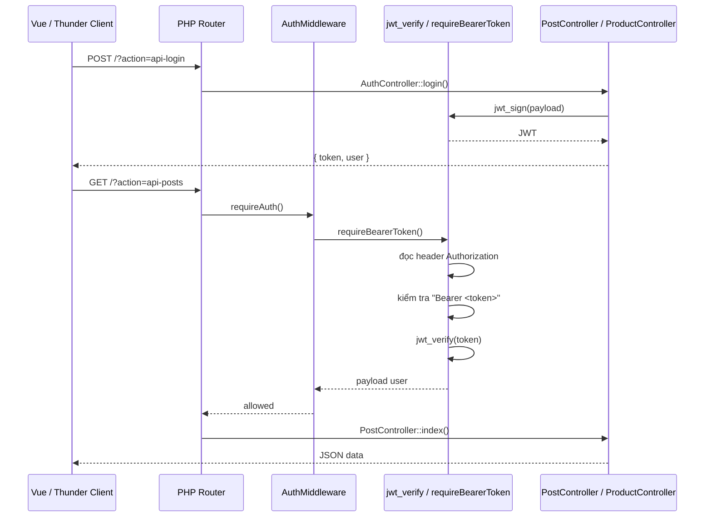

# Auth & Middleware Guide

Tài liệu này mô tả cơ chế xác thực hiện tại của project: JWT + Bearer token + middleware guard theo kiểu tối giản, phù hợp cho PHP MVC mini app.

## Mục tiêu

- Không cần framework auth phức tạp
- Không cần Composer package
- Dễ debug, dễ hiểu
- Hỗ trợ API protected và frontend Vue
- Không lưu token trực tiếp trong bảng users

## Luồng auth



## Cơ chế thực thi

### 1. Login

Khi client gửi request login:

```http
POST /BE/?action=api-login
Content-Type: application/json
```

Body ví dụ:

```json
{
  "email": "admin@example.com",
  "password": "123456"
}
```

Backend kiểm tra email/password. Nếu đúng, server tạo JWT với payload như:

```php
[
  'sub' => 1,
  'email' => 'admin@example.com',
  'role' => 'admin'
]
```

Dùng hàm:

```php
$token = jwt_sign([
    'sub' => $user['id'],
    'email' => $user['email'],
    'role' => $user['role'],
]);
```

## 2. Frontend lưu token

Frontend lưu token và thông tin user vào localStorage:

```js
setAuthSession(data.token, data.user)
```

Ví dụ trong [FE/src/services/auth.js](FE/src/services/auth.js):

```js
localStorage.setItem('auth_token', token)
localStorage.setItem('auth_user', JSON.stringify(user))
```

Sau đó Axios interceptor tự gửi header:

```js
config.headers.Authorization = `Bearer ${token}`
```

## 3. Middleware kiểm tra token

Mỗi route protected đều gọi:

```php
(new AuthMiddleware())->requireAuth();
```

Trong [BE/routes/index.php](BE/routes/index.php):

```php
case 'api-posts':
    (new AuthMiddleware())->requireAuth();
    (new PostController)->index();
    break;
```

Middleware gọi `requireBearerToken()` từ helper.

## 4. requireBearerToken()

Hàm này đọc header:

```http
Authorization: Bearer <token>
```

và thực hiện các bước sau:

1. đọc `$_SERVER['HTTP_AUTHORIZATION']`
2. fallback nếu header không nằm ở biến chuẩn
3. kiểm tra regex dạng `Bearer ...`
4. nếu sai → trả 401 JSON
5. nếu đúng → gọi `jwt_verify()`

Ví dụ:

```php
if (!preg_match('/^Bearer\s+(.+)$/i', $authHeader, $matches)) {
    response_json([
        'status' => 'error',
        'message' => 'Unauthorized: thiếu Bearer token'
    ], 401);
}
```

## 5. jwt_verify()

Hàm verify JWT làm 3 việc chính:

1. tách token thành 3 phần: `header.payload.signature`
2. rebuild chữ ký bằng secret key `JWT_SECRET`
3. so sánh chữ ký và kiểm tra `exp`

Nếu token sai hoặc hết hạn thì trả lỗi:

```json
{
  "status": "error",
  "message": "Unauthorized: Chữ ký token không hợp lệ"
}
```

## 6. Vì sao không lưu token trong users?

Với mô hình JWT stateless:

- server không cần lưu token vào DB
- mỗi request đều mang token kèm theo
- server chỉ cần verify chữ ký và exp
- app nhẹ, dễ triển khai, dễ scale

Điều này phù hợp với mini project hoặc API backend riêng biệt.

## 7. Logout

Với JWT stateless, logout thực chất là:

- client bỏ token khỏi bộ nhớ / localStorage
- server không cần xoá token ở DB

Trong backend, logout vẫn có thể validate token nếu có và trả success:

```php
public function logout()
{
    $payload = requireBearerToken();
    response_json([
        'status' => 'success',
        'message' => 'Đăng xuất thành công',
        'user' => $payload
    ]);
}
```

## 8. Response chuẩn

Khi thiếu token:

```json
{
  "status": "error",
  "message": "Unauthorized: thiếu Bearer token"
}
```

Khi token hợp lệ:

```json
{
  "status": "success",
  "posts": [
    { "id": 1, "title": "..." }
  ]
}
```

## 9. File quan trọng

- [BE/configs/helper.php](BE/configs/helper.php): `jwt_sign`, `jwt_verify`, `requireBearerToken`, `response_json`
- [BE/extensions/AuthMiddleware.php](BE/extensions/AuthMiddleware.php): middleware wrapper
- [BE/routes/index.php](BE/routes/index.php): route protected
- [BE/controllers/AuthController.php](BE/controllers/AuthController.php): login/logout API
- [FE/src/services/auth.js](FE/src/services/auth.js): lưu token/user
- [FE/src/services/api.js](FE/src/services/api.js): tự gắn Authorization

## 10. Kết luận

Cơ chế auth hiện tại là phiên bản tối giản nhưng đủ dùng cho mini project:

- JWT HS256
- Bearer token
- Middleware guard
- Stateless auth
- Không cần thư viện phức tạp

Nếu cần mở rộng thực tế sau này, có thể thay bằng database-backed user auth, refresh token, role permission, hoặc session server-side. Nhưng với mục tiêu hiện tại, cách này là đơn giản, rõ và dễ debug nhất.
